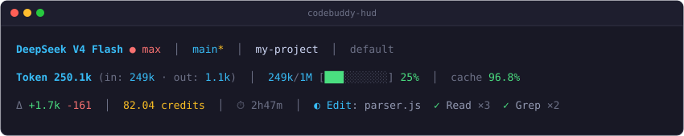

# CodeBuddy HUD

[](https://github.com/XisFool/codebuddy-hud/actions/workflows/ci.yml)
[](https://github.com/XisFool/codebuddy-hud/releases/latest)
[](https://nodejs.org/)
[](#安装)
[](LICENSE)

> 面向 **CodeBuddy Code** 的终端状态栏看板与插件（StatusLine HUD Plugin），提供类似 Claude Code `cc-hud` 的事件驱动监控体验。
>
> 宿主在会话事件后触发刷新，以严格 ≤3 行 ANSI 展示当前模型与推理强度、Git 分支状态、上下文 Token 用量、Prompt Cache 命中率、代码变更差异、实际会话消费（Credits）与工具活动调用频次。
>
> 纯 Node.js 内置模块实现（零 npm 依赖）；push 到 master/main、PR 与每日定时任务会在 **macOS / Linux / Windows × Node 18/20/22** 矩阵上运行单元测试与安装验证。

[English](./README_en.md)

---

## 效果预览



**UTF-8 终端**：

```text
Deepseek-V4.1-Flash ● max  │  main*  │  my-project  │  default
Context Token 249k/1M [███░░░░░░░] 25%  │  out 1.1k  │  cache 96.8%
Δ +1.7k -161  │  82.04 credits  │  ⏱ 2h47m  │  ◐ Edit: parser.js  ✓ Read ×3  ✓ Grep ×2
```

**GBK 终端**（Windows 默认代码页 936 等 Unicode 支持不佳的环境）自动降级为纯 ASCII 字形，数据与布局不变：

```text
Deepseek-V4.1-Flash max  |  main*  |  my-project  |  default
Context Token 249k/1M [###-------] 25%  |  out 1.1k  |  cache 96.8%
[D] +1.7k -161  |  82.04 credits  |  [t] 2h47m  |  [A] Edit: parser.js  [T] Read ×3  [T] Grep ×2
```

> 可用 `CODEBUDDY_HUD_FORCE_ASCII=1` / `CODEBUDDY_HUD_FORCE_UNICODE=1` 强制指定形态；乱码排查见「诊断」。

### 布局说明

- **Line 1（身份）**：模型名称、推理强度（如 `● max`）、Git 分支（`*` 表示有未提交改动）、工作区目录名、当前权限模式。
- **Line 2（资源）**：当前上下文输入占用、窗口进度条与百分比（分子口径与宿主 `used_percentage` 一致）、输出 Token 与近期 Prompt Cache 命中率（滑动窗口聚合）；压缩后宿主尚未提供新 usage 时显示 `--` 和等待提示。
- **Line 3（会话活动）**：代码变更行数 `Δ +N -M`（ASCII 终端降级为 `[D]`）、会话实际消费（credits；不可得时回退 `$USD`）、会话耗时、AI 当前动作、本轮已完成工具调用频次（最多 3 项）。Δ / credits / ⏱ 为会话基线累计（仅 `/clear` 重置），工具计数按当前轮 transcript 扫描。

3 行为硬上限，对齐宿主 CodeBuddy Code（实测至 v2.171.0+ 均按 stdout 前 3 行截断）；无数据的行整体隐藏，单个字段无数据时显示 `--` 占位（如 `cache --`）。

---

## 安装

要求：Node.js >= 18（安装脚本会先校验）。在普通终端中执行一条命令，无需克隆仓库或配置环境。

**Windows（PowerShell）**

```powershell
irm https://raw.githubusercontent.com/XisFool/codebuddy-hud/master/scripts/install.ps1 | iex
```

**Windows（CMD）**

```cmd
powershell -ExecutionPolicy Bypass -Command "irm https://raw.githubusercontent.com/XisFool/codebuddy-hud/master/scripts/install.ps1 | iex"
```

**macOS / Linux（Bash）**

```bash
curl -fsSL https://raw.githubusercontent.com/XisFool/codebuddy-hud/master/scripts/install.sh | bash
```

> **为什么不是一条插件安装命令？** 插件清单（`.codebuddy-plugin/plugin.json`）只声明元数据，不会下载运行时，也不会写入 `settings.json` 的 `statusLine`（宿主清单 schema 无该字段），这些由安装脚本完成。

安装器会：

1. 查询最新 Release 的 `tag_name` 并将 runtime 固定到该 release（下载失败最多重试 3 次，按 1s、2s 退避；`bootstrap.js` 自身仍取自 master）。
2. 部署 runtime 至 `~/.codebuddy/codebuddy-hud-runtime/`（核心代码在 `runtime/` 子目录）。
3. 备份并写入 `~/.codebuddy/settings.json` 的 `statusLine.command`；Windows 另生成烘焙 Node 绝对路径的 `.cmd` shim，不依赖系统 PATH。
4. 注册 PATH：Windows 追加到用户级注册表 PATH；macOS / Linux 在 PATH 含 `~/.local/bin` 时创建软链接。`CODEBUDDY_HUD_NO_PATH=1` 可跳过。
5. 挂载 `hud-config` 技能至 `~/.codebuddy/skills/hud-config/`（Windows 优先 Junction，POSIX 优先软链接，失败降级为复制），之后可在会话内用自然语言换肤与定制。

**幂等**：重复运行同一条命令即可修复、升级或清理旧版本残留。

**更新**：`codebuddy-hud --update` 一键检查并升级到最新 Release（也可重跑安装命令）。更新完全由用户主动触发，渲染路径不发起任何网络请求。

**触发方式**：安装后重启 CodeBuddy Code 并发送任意一条消息。宿主在会话事件后约 300ms 去抖刷新，空闲会话不绘制状态栏，刚进入会话时底部为空属正常现象。

**网络受限、离线或自建发行源**：镜像加速、Git Clone 本地安装、Fork 安装见 [docs/install-advanced_zh.md](docs/install-advanced_zh.md)。

---

## 安装验证

```bash
# 1. settings.json 中应存在指向 runtime 的 statusLine.command
grep -A2 '"statusLine"' ~/.codebuddy/settings.json

# 2. 直接运行入口，应以演示数据渲染 3 行看板后退出
node ~/.codebuddy/codebuddy-hud-runtime/runtime/bin/codebuddy-hud.js --status
```

Windows PowerShell：

```powershell
Get-Content "$env:USERPROFILE\.codebuddy\settings.json"
& "$env:USERPROFILE\.codebuddy\codebuddy-hud-runtime\runtime\bin\codebuddy-hud.cmd" --status
```

> 下文以 `codebuddy-hud` 简记入口：一键安装已自动注册 PATH；若未生效，请确认 `~/.local/bin` 在 PATH 中或使用上面的完整路径。

以下现象属正常降级，不是安装失败：

- 会话空闲时底部为空 —— 宿主仅在会话事件后刷新，发送一条消息即出现。
- `cache --` 或 Credits 缺失 —— 当前供应商未返回对应遥测字段，或 transcript 扫描尚未完成，HUD 按契约降级/隐藏，不伪造数据。

---

## 诊断

```bash
codebuddy-hud --doctor   # 体检 Node 环境、settings.json 与 statusLine 指向、终端编码、Git、transcript 访问
```

| 现象 | 处理 |
| :--- | :--- |
| 底部始终无 HUD | 先发送任意消息触发刷新；仍无则运行 `--doctor` 检查配置指向 |
| ⏱ 耗时或工具状态不会实时走字跳动 | 正常现象，见「宿主刷新机制与局限说明」 |
| 乱码 / 方块符号 | 运行 `chcp 65001` 切换 UTF-8；仍不兼容时设 `CODEBUDDY_HUD_FORCE_ASCII=1`，或设 `CODEBUDDY_HUD_FORCE_UNICODE=1` 强制 Unicode |
| `cache --` / 无消费数据 | 遥测字段不可得时的正常降级，见「安装验证」 |
| `/clear` 后 Δ / 耗时表现 | 宿主会切换新 transcript，HUD 自动重建基线并重置 Δ / 耗时，发送下一条消息后生效 |
| 需要排查底层错误 | 查看 `~/.codebuddy/codebuddy-hud-error.log`（超过 1MB 自动轮转） |

---

## 卸载

```bash
codebuddy-hud --uninstall
```

卸载程序会：

- 仅当当前 `statusLine` 仍指向本 HUD 时，从安装时的备份还原；若备份里的命令本身也指向 codebuddy-hud，则直接移除 `statusLine` 项。安装后你自行替换或删除的 `statusLine` 保持不变。
- 删除 Windows `.cmd` shim，清理 HUD 自身的缓存与状态文件，清理挂载的 `hud-config` 技能目录与软链接。
- 清理 PATH 注册：移除 Windows 用户级注册表 PATH 中的 runtime bin 目录；macOS / Linux 上删除 `~/.local/bin/codebuddy-hud` 软链接（设置了 `CODEBUDDY_HOME` 时自动跳过）。

用户主题配置（`codebuddy-hud.config.json`）与 `~/.codebuddy/codebuddy-hud-runtime/` 运行时目录会被保留（可手动删除）；除 `statusLine` 外不会改动 `settings.json` 的其他配置项。

---

## 主题

内置 5 套主题，每套均提供深色 / 浅色两种配色：

| 主题 | 说明 |
| :--- | :--- |
| `ocean`（默认） | 深海青蓝 |
| `emerald` | 翡翠绿 |
| `cyberpunk` | 赛博朋克（粉紫 + 荧光青） |
| `amber` | 琥珀金 |
| `monochrome` | 黑白极简 |

```bash
codebuddy-hud --theme           # 交互式选择：↑/↓ 实时预览，1-5 数字快选，Enter 确认，Esc 取消
codebuddy-hud --theme cyberpunk # 直接指定
codebuddy-hud --theme list      # 仅列出全部主题
```

也可以在 CodeBuddy Code 会话中直接描述需求（内置 `hud-config` Skill 会写入配置），例如：“把 HUD 主题换成 cyberpunk”。

`themeMode` 默认 `auto`，结合终端背景信号（如 `COLORFGBG`）自动切换深 / 浅配色，也可强制 `dark` 或 `light`。

---

## 配置

可选。在项目根目录创建 `codebuddy-hud.config.json` 仅对当前项目生效；在 `~/.codebuddy/` 创建同名文件对所有项目生效。优先级：项目 > 用户 > 内置默认。下面是完整字段与默认值：

```json
{
  "theme": "ocean",
  "themeMode": "auto",
  "language": "zh",
  "defaultEffortLevel": "medium",
  "thresholds": {
    "warning": 0.7,
    "critical": 0.9
  },
  "cacheHitThresholds": {
    "excellent": 80,
    "partial": 50
  },
  "display": {
    "showTokenBar": true,
    "showCacheHitRate": true,
    "showDiffStats": true,
    "showCost": true,
    "showDuration": true,
    "showToolActivity": true,
    "showGitBranch": true,
    "showCurrentDir": true,
    "showVersion": false,
    "showPermissionMode": true,
    "maxLines": 3,
    "progressBarWidth": 10,
    "toolActivityTailBytes": 16384,
    "useNerdFonts": false,
    "unicode": "auto"
  }
}
```

- `language`：界面语言 `zh` / `en`（内置默认 `en`；设为其他值时按系统 locale 判定）。
- `defaultEffortLevel`：未捕获到推理强度时的回退档位，可选 `low`、`medium`、`high`、`xhigh`、`max`、`ultracode`。
- `thresholds`：上下文进度条的警告 / 危险阈值；`cacheHitThresholds`：缓存命中率配色分级阈值。
- `display.*`：各片段开关与显示参数。`maxLines` 超过宿主硬截断的 3 行不会多显示，建议保持默认；`toolActivityTailBytes` 是工具活动的尾读字节数；`unicode` 取值 `auto` / `true` / `false`。

### 环境变量

| 变量 | 作用 |
| :--- | :--- |
| `CODEBUDDY_HOME` | 覆盖 `~/.codebuddy` 宿主目录（安装、状态、技能、缓存） |
| `CODEBUDDY_SETTINGS_PATH` | 覆盖宿主 `settings.json` 路径 |
| `CODEBUDDY_HUD_DIR` | 覆盖 runtime 安装目录（bootstrap） |
| `CODEBUDDY_HUD_VERSION` | 指定 bootstrap 安装的 Release tag；`--update` 自行查询最新 Release |
| `CODEBUDDY_HUD_MIRROR` | 为安装、更新与 tag 查询添加镜像前缀 |
| `CODEBUDDY_HUD_BOOTSTRAP_URL` | 覆盖 bootstrap.js 下载源（安装与 `--update`） |
| `CODEBUDDY_HUD_LATEST_RELEASE_URL` | 覆盖 Latest Release 查询 URL（旧名 `CODEBUDDY_HUD_REMOTE_PKG_URL`） |
| `CODEBUDDY_HUD_RAW_BASE` | 直接指定 runtime 下载源并跳过 tag 查询 |
| `CODEBUDDY_HUD_NO_PATH` | 设为 `1` 跳过安装时的 PATH 自动注册 |
| `CODEBUDDY_HUD_FORCE_ASCII` / `CODEBUDDY_HUD_FORCE_UNICODE` | 强制 ASCII / Unicode 字形 |
| `CODEBUDDY_HUD_NO_GIT_CACHE` | 设为 `1` 绕过 Git 持久化缓存 |

镜像与 Fork 相关变量的用法见 [docs/install-advanced_zh.md](docs/install-advanced_zh.md)。

---

## 命令行参考

| 命令 | 说明 |
| :--- | :--- |
| `--setup [--theme <name>]` | 将 `statusLine` 写入 `settings.json`、生成 Windows `.cmd` shim 并挂载 `hud-config` 技能（TTY 下自动唤起交互主题选择器，也可带 `--theme <name>` 直接指定；供源码本地安装使用，PATH 注册由一键安装脚本完成） |
| `--status` | 以演示数据渲染一次看板并退出 |
| `--theme [name\|list]` | 交互式主题选择器；`list` 列出主题；带名称时直接切换 |
| `--doctor` / `-d` `[--json]` | 输出环境诊断报告（`--json` 输出结构化数据） |
| `--update` | 检查最新 Release 并在落后时下载 bootstrap 完成自举升级（仅用户主动调用） |
| `--uninstall` | 卸载并在当前 `statusLine` 仍指向本 HUD 时从备份还原配置，清理已挂载技能与 PATH 注册 |
| `--version` / `-v` | 输出当前版本号并退出 |
| `--help` / `-h` | 输出命令行选项帮助信息并退出 |

`--version`/`-v`、`--help`/`-h` 优先于安装、卸载等操作，且不读取 stdin。`--theme --help`（或 `--theme -h`）只列出主题，TTY 下也不交互；与 `--setup` 组合时显示全局帮助。

---

## 跨平台说明

- **Windows**：`.cmd` shim 烘焙 Node 绝对路径，检测到非 ASCII 路径时自动注入 `@chcp 65001`；建议避免把仓库或运行时放在含空格或引号的路径中。
- **ASCII 降级**：终端不支持 Unicode 时自动切换为纯 ASCII 符号，功能不受影响。
- **macOS / Linux**：直接以 `node` 调用入口，无需 shim。

---

## 宿主刷新机制与局限说明

**为什么 ⏱ 耗时不能像秒表一样走字？为什么长时间工具执行期间工具活动不实时跳动？** 这是 CodeBuddy Code 宿主的架构契约，并非 HUD 缺陷：

- 宿主为每次刷新派生一次性子进程，经 stdin 喂入 JSON 并读取 stdout，单次执行有 **5000ms 硬超时**，超时即 kill 并清空状态栏。
- 宿主没有周期性定时器，仅在 session / result / permission / settings / cost 五类离散事件后以 **300ms 防抖**触发；stdout 捕获上限 10240 个 UTF-16 字符，只取前 3 行。
- 长时间工具执行、模型流式生成与终端空闲期间，宿主不会触发 statusLine 命令。

实测至 CodeBuddy Code **v2.171.0**（2026-10-21 复核）该机制不变。HUD 单次渲染 p50 约 200ms（经 `.cmd` shim 约 0.15–0.32s）。完整宿主契约与故障矩阵见 [docs/architecture_zh.md](docs/architecture_zh.md) §4 与 §7。

---

## 开发

```bash
git clone https://github.com/XisFool/codebuddy-hud.git
cd codebuddy-hud

node runtime/bin/codebuddy-hud.js --setup   # 注册到本机 CodeBuddy
npm link                                    # 可选：全局 codebuddy-hud 命令

npm test && npm run verify && npm run verify:install   # 全量验证
```

CI 会在 push 到 master/main、PR 与每日定时任务时运行 3 OS × Node 18/20/22 矩阵：`npm test`（单元测试）、`npm run verify`（E2E：payload 渲染、CLI 形态与边界场景）、`npm run verify:install`（隔离宿主下的真实安装 / 卸载，CI 直接调用 `node scripts/verify-install.js`）。

参考文档：

- [AGENTS.md](AGENTS.md) — 开发硬约束、避坑指南与提交验证闭环（含源码目录结构）。
- [docs/architecture_zh.md](docs/architecture_zh.md) — 系统架构与数据流（英文版：[architecture.md](docs/architecture.md)）。
- [docs/module-reference.md](docs/module-reference.md) — 模块接口与落盘状态参考。
- [docs/install-advanced_zh.md](docs/install-advanced_zh.md) — 镜像、本地与 Fork 安装。
- [CHANGELOG.md](CHANGELOG.md) — 版本变更记录。

---

## 许可证

本项目基于 [MIT License](LICENSE) 开源发布。
