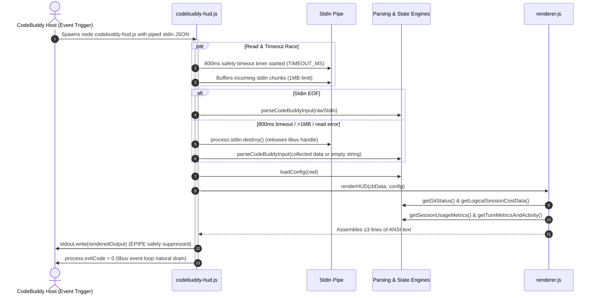

# CodeBuddy HUD System Architecture

> **Target Version:** `v0.3.9+`  
> **Host Compatibility:** CodeBuddy Code CLI (including latest v2.171.0+; subject to the Windows quoting and three-line display contracts below)
> **Engine Baseline:** Pure Node.js Standard Library (`>= 18.0.0`, Zero npm dependencies)

---

## 1. Overview & Core Philosophy

`codebuddy-hud` is a high-performance terminal statusline HUD plugin designed for the **CodeBuddy Code** AI pair-programming assistant. It renders compact, high-density telemetry only when the host fires session events; idle periods, read-only tool execution, and streaming generation do not refresh it.

### Core Architectural Invariants:
1. **Zero External Dependencies**: Implemented strictly using Node.js built-in standard libraries (`fs`, `path`, `os`, `crypto`, `child_process`, `readline`, `https`, `http`). No `node_modules` installation is required.
2. **Statusline Host Contract**:
   - **Execution Budget**: $\le 1500\text{ms}$ total, with an internal stdin read timeout of $800\text{ms}$. Timers cannot preempt synchronous filesystem calls or JSON parsing.
   - **Constant Zero Exit Code**: The process must **always** terminate with `process.exitCode = 0`. Uncaught runtime exceptions are redirected to `~/.codebuddy/codebuddy-hud-error.log` (mode `0o600`, capped at 1MB with auto-rotation) to prevent host terminal disruption.
   - **Output Height Boundary**: Strictly $\le 3$ ANSI-formatted terminal lines, aligned with the host's 3-line truncation limit. Unused or empty lines are dynamically pruned.
3. **Truthful & Non-Fabricated Telemetry**: Prompt Cache hit percentages come exclusively from authentic session `transcript.jsonl` records (no payload fallback; absent telemetry renders `cache --`). Cumulative Credits prefer the transcript checkpoint and fall back to payload-declared spend only when no transcript telemetry exists; incomplete scans are hidden. Nothing is fabricated.

---

## 2. Two-Layer Physical Design

`codebuddy-hud` separates plugin metadata from the runtime execution engine:

```
┌──────────────────────────────────────────────────────────────────────────┐
│  PLUGIN LAYER  CodeBuddy / Agent Discovery Entrypoint (root & skills/)    │
│   .codebuddy-plugin/plugin.json · skills/hud-config/SKILL.md             │
└────────────────────────────────────┬─────────────────────────────────────┘
                                     │  bootstrap.js atomic install & overwrite
┌────────────────────────────────────▼─────────────────────────────────────┐
│  RUNTIME LAYER  ~/.codebuddy/codebuddy-hud-runtime/ or local source      │
│   runtime/bin/codebuddy-hud.js    ← registered to settings.json statusLine│
│   runtime/bin/codebuddy-hud.cmd   ← Windows absolute-path node shim       │
│   codebuddy-hud.config.json (built-in config template; presets in config.js)│
│   parser.js · config.js · paths.js · encoding.js · git.js · sanitize.js  │
│   lang.js · model-info.js · settings-file.js · statusline-installer.js   │
│   theme-selector.js · doctor.js · session-stats.js                       │
│   transcript.js (sliding-window telemetry & SHA-256 checkpoint) · uninstall│
│   update-checker.js (--update version resolution & self-upgrade)          │
│   renderer.js (3-line layout engine) ──> renderer/ (format, diff, agents) │
└──────────────────────────────────────────────────────────────────────────┘
```

- **Plugin Layer**: Defines `.codebuddy-plugin/` metadata and `skills/hud-config/` capabilities for automated AI Agent configuration.
- **Runtime Layer**: Implements full telemetry parsing, rendering, state management, and platform shims.

---

## 3. Module Dependency Topology

> **Note**: This diagram illustrates the primary end-to-end execution flows. Module signatures, constants, and persisted-state contracts are detailed in [docs/module-reference.md](module-reference.md).

```mermaid
graph TD
    Entry["runtime/bin/codebuddy-hud.js"] --> Parser["runtime/parser.js"]
    Entry --> Config["runtime/config.js"]
    Entry --> Renderer["runtime/renderer.js"]
    Entry --> Doctor["runtime/doctor.js"]
    Entry --> ThemeSelector["runtime/theme-selector.js"]
    Entry --> Installer["runtime/statusline-installer.js"]
    Entry --> Uninstall["runtime/uninstall.js"]
    Entry --> UpdateChecker["runtime/update-checker.js (--update)"]
    Entry --> Paths["runtime/paths.js"]
    Entry --> Sanitize["runtime/sanitize.js"]
    Entry --> Lang["runtime/lang.js"]

    Config --> SettingsFile["runtime/settings-file.js"]
    Config --> Paths
    SessionStats["runtime/session-stats.js"] --> Parser
    SessionStats --> Paths
    ModelInfo["runtime/model-info.js"] --> Paths
    ModelInfo --> SettingsFile
    Git --> Paths
    Encoding --> Paths

    Renderer --> Transcript["runtime/transcript.js"]
    Renderer --> SessionStats
    Renderer --> Format["runtime/renderer/format.js"]
    Renderer --> DiffRender["runtime/renderer/diff-render.js"]
    Renderer --> AgentsRender["runtime/renderer/agents-render.js"]
    Renderer --> Encoding["runtime/encoding.js"]
    Renderer --> Git["runtime/git.js"]
    Renderer --> Sanitize
    Renderer --> Parser
    Renderer --> ModelInfo["runtime/model-info.js"]
    Renderer --> Lang

    Transcript --> Sanitize
    Transcript --> Paths
    Doctor --> Lang
    Doctor --> Paths
    Doctor --> Encoding
    Doctor --> Git
    Doctor --> Config
    Doctor --> Sanitize
    Doctor --> SettingsFile
    ThemeSelector --> Config
    ThemeSelector --> Paths
    ThemeSelector --> Sanitize
    ThemeSelector --> Lang
    ThemeSelector --> Format
    Installer --> Paths
    Installer --> SettingsFile
    Installer --> Sanitize
    Installer -.->|lazy| ThemeSelector
    Uninstall --> Paths
    Uninstall --> SettingsFile
    Uninstall --> Sanitize
```



---

## 4. Execution Lifecycle & Timing

The host (verified up to latest v2.171.0) debounces statusline invocations by ~300ms across **session / result / permission / settings / cost** event streams. Each execution has a **5000ms wall-clock hard timeout**; stdout capture is capped at **10240 UTF-16 characters** (length checked before appending) and only the first 3 lines are retained. Idle sessions and read-only tool executions do not poll; failed executions clear the statusline without automatic retry.



---

## 5. Core Subsystems & Algorithms

> This section explains only why each subsystem is designed the way it is; signatures, constants, predicates and state-file schemas live solely in the matching [module-reference.md](module-reference.md) sections.

### 5.1 Sliding-Window Telemetry Scanner (`transcript.js`)
Prompt Cache hits, actual Credits and the tool-call sequence exist only in `transcript.jsonl`, which can reach dozens of megabytes, so only the file tail is read: one backward pass aggregates turn usage and tool activity, reassembles lines that straddle chunk boundaries, and stops at the latest `role: 'user'` so metrics describe the **current turn**; when a turn outgrows the scan budget the window simply stops at the most recent calls and the metric becomes the **recent-invocations hit rate** (`sum(hitTokens) / sum(promptTokens)`). Cumulative Credits uses a separate forward incremental scan (§5.4). Context freshness (`contextStatus`: `fresh`/`stale`/`unknown`) detects the window after `/compact` in which the host still reports old usage, and tolerates providers (e.g. DeepSeek) that count a miss as creation so the host deducts input down to 0. Budget constants, field priority and `createContextTracker` / `resolveReportedInputs` / `getCompactContextStatus` are in [module-reference.md §10](module-reference.md#10-runtimetranscriptjs--逆向滑窗遥测与-checkpoint-状态机).

### 5.2 Git Branch & Status Non-Blocking Probing (`git.js`)
The goal is that no frame pays subprocess cost for Git: `.git/HEAD` is read directly with zero spawns, a shell-free `git status` with a short timeout runs only when dirty state is needed, tiered positive/negative caches stop failures and non-repo directories from respawning, and `child_process` is lazy-loaded. Exact timeouts, TTLs and `CODEBUDDY_HUD_NO_GIT_CACHE` semantics are in [module-reference.md §12](module-reference.md#12-runtimegitjs--git-分支与状态探测器).

### 5.3 Session Baseline Tracking & `/clear` Detection (`session-stats.js`)
`/clear` resets the host context window, but cumulative lines, duration and tokens in the payload can drop non-monotonically or retain stale history. The HUD therefore persists a session baseline and rebuilds it when a reset signal appears (context cliff / return to initial / cumulative counters regressing / transcript or session switch / explicit clear signal), so Δ and ⏱ reflect only the current session. An identity miss is simply a new session: the current payload cumulative becomes the new baseline with no cross-identity shared state (the legacy handoff mechanism is retired). Predicates, thresholds and the state schema are in [module-reference.md §11](module-reference.md#11-runtimesession-statsjs--会话基线与-clear-重置状态机) and [§15](module-reference.md#15-runtimepathsjs--跨平台路径解析与目录管理).

### 5.4 Incremental SHA-256 Checkpointing for Credits (`transcript.js`)
Re-scanning a long JSONL on every event would re-parse existing spend records, so state is isolated by SHA-256 of the transcript absolute path and only appended records are parsed from `offset`; size, mtime/ctime and content hash detect truncation, rotation and in-place rewrites, which trigger a full rebuild. The scan has a 100ms budget: an incomplete scan saves progress and returns `complete: false`, and the renderer **hides** Credits rather than falling back to payload values (truthful telemetry, §1); a partially written trailing line waits for the next run. Budget, invalidation predicates and the version 5 schema are in [module-reference.md §10](module-reference.md#10-runtimetranscriptjs--逆向滑窗遥测与-checkpoint-状态机) and [§15](module-reference.md#15-runtimepathsjs--跨平台路径解析与目录管理).

### 5.5 Multi-Layer Configuration & Theme Engine (`config.js`)
Configuration is merged with `deepMerge` over four layers (built-in defaults → bundled → global user → project local) and then `resolveTheme` post-processes it (post-processing, not a merge layer; `--theme <name>` is a persistent write to user config, not a runtime overlay). Project configs are untrusted, so merging skips `__proto__` and caps recursion depth, theme overrides must be strict SGR sequences or short constrained strings, and unknown color names degrade to unstyled text, blocking terminal injection. The transcript effort signal is persisted per transcript hash so long tasks can adjudicate from a tail scan and have a cold-start fallback. The five presets, validation rules and the effort resolution chain are in [module-reference.md §3](module-reference.md#3-runtimeconfigjs--多层配置合并与主题引擎) and [§8](module-reference.md#8-runtimemodel-infojs--推理强度归一化与额度回退).

### 5.6 3-Line Adaptive Layout (`renderer.js`)
The host (verified as a hard constant up to v2.171.0) retains only the first three stdout lines, and the HUD's three-line contract is strictly aligned with it: Line 1 identity & status, Line 2 tokens & context, Line 3 diff / cost / duration with tool activity **merged in**, so every key segment survives truncation; rows with no data are hidden whole and missing fields render as `--`. Line 2 uses three states (`fresh` / `stale` / `unknown`) to express how trustworthy the context data is, so stale numbers are not shown after `/compact`. Per-line fields, layout and tri-state rendering are in [module-reference.md §4](module-reference.md#4-runtimerendererjs--3-行看板装配与布局编排).

---

## 6. Security Threat Model & Terminal Defense

`codebuddy-hud` implements defensive sanitization on **every** dynamic string before output:

| Threat Vector | Attack Payload Example | Defense Mechanism (`runtime/sanitize.js`) |
| :--- | :--- | :--- |
| **ANSI CSI Escape Injection** | `\x1b[2J\x1b[H` (Clear screen exploit) | Strips all CSI sequences matching `/\x1b\[[0-?]*[ -/]*[@-~]/g`. |
| **OSC Escape Payloads** | `\x1b]52;c;...\x07` (Clipboard hijack) | Strips OSC sequences (including the C1 `0x9D` form) through BEL / ST (`\x1b\\`, `0x9C`) / end of input. |
| **DCS/APC/PM/SOS String Injection** | `\x1bP+q544e\x1b\\`, `\x1b_G...\x1b\\` | Swallows the whole string sequence through ST or end of input (including C1 `0x90/0x98/0x9E/0x9F` forms); the payload cannot surface as text. |
| **Bidi Text Disguise** | `\u202E` (Right-to-Left Override) | Removes bidirectional/format Trojan characters (`U+200B`-`U+200F`, `U+202A`-`U+202E`, `U+2028`/`U+2029`, `U+2060`, `U+2066`-`U+206F`, `U+061C`). |
| **Terminal Control Chars** | `\x00-\x1F`, `\x7F-\x9F` | Strips all C0/C1 control codes (including NUL and the single-byte `0x9B` CSI / `0x9D` OSC forms; string sequences are swallowed whole as above). |
| **Oversized String Floods** | 50,000 char git branch name | Hard truncation to safe viewport boundaries (default cap 120 chars; call sites tighten to 10-1024). |

---

## 7. System Failure Modes & Degradation Matrix

| Failure Event | Root Cause | System Degradation Behavior | Exit Code |
| :--- | :--- | :--- | :---: |
| **Empty Stdin / Malformed** | Early hook trigger (payload not ready) / payload >1MB / invalid JSON | Exits safely with no output (0 bytes); writes diagnostic reason to error log; no invented telemetry. | `0` |
| **Stdin Hang** | Host pipe remains open without sending EOF | $800\text{ms}$ timeout timer fires, forcibly closes stdin and renders collected input. | `0` |
| **EPIPE Error** | Host kills statusline process while stdout writing | `process.stdout.on('error', () => {})` swallows error cleanly. | `0` |
| **Missing Transcript** | First turn / remote headless session | Omits tool activity, falls back to payload-supplied token counts, and resolves Credits strictly from payload-declared spend. | `0` |
| **Corrupt JSONL / State** | Process killed mid-write | Checkpoint discarded; resets byte offset to 0 and rebuilds from start. | `0` |
| **Readonly Filesystem** | Permission restricted container | State writes fail silently; incomplete Credits scans remain hidden and may restart on later invocations. | `0` |
| **Git Timeout / Non-repo** | Huge mono-repo / unusable repository | Falls back to a directly readable branch (`dirty: null`); only records a 60s negative cache when no HEAD is available, preventing repeated spawns. | `0` |

---

## 8. Cross-Platform & Zero-Dependency Guarantees

1. **Windows `.cmd` Shim Path Baking**:
   - `statusline-installer.js` bakes the exact `process.execPath` into `codebuddy-hud.cmd` during `--setup`.
   - Batch percent characters (`%`) in paths are automatically escaped as `%%` to avoid `cmd.exe` variable substitution corruption.
   - When paths contain non-ASCII characters, `resolveShortPath()` resolves Windows 8.3 short paths and prepends `@chcp 65001 >nul` to prevent `cmd.exe` parse crashes.
   - The shim is UTF-8, with `chcp 65001` when needed; UTF-16LE batch files are not supported by the tested cmd.exe invocation.
   - Windows host launcher double-escapes literal quotes across versions. Safe ASCII shim paths are left unquoted; paths requiring quotes retain them and remain subject to the host limitation.
2. **Terminal UTF-8 Auto-Detection**: On Windows the code page is probed by spawning `chcp.com` directly without a shell; success and failure use different cache lifetimes so a transient spike cannot pin ASCII degradation for an hour. `CODEBUDDY_HUD_FORCE_ASCII`/`UNICODE` takes precedence. Terminals without UTF-8 fall back to ASCII glyphs (`#`, `-`, `|`, `[A]`, `[Q]`, `[D]`, `[t]`, `[T]`). TTLs and timeouts are in [module-reference.md §13](module-reference.md#13-runtimeencodingjs--终端字符集探测与编码缓存).
3. **Natural Event Loop Drain**: The rendering path never calls `process.exit()`; it releases stdin and timer handles and lets libuv drain, so stdout buffers are not truncated into half an ANSI sequence. Stdout `EPIPE` is likewise swallowed silently (see §7).
4. **Settings Writes & Uninstall Cleanup**: Settings writes preserve string content, permissions and symlinks and reject multi-hardlink targets ([§16](module-reference.md#16-runtimesettings-filejs--jsonc-安全解析与配置原子写入)); uninstall restores only a non-HUD `statusLine` and symmetrically cleans the skill deployment, shim, caches and system PATH registration, skipping PATH cleanup in sandbox testing (`CODEBUDDY_HOME` set) ([§20](module-reference.md#20-runtimeuninstalljs--卸载还原与深度清理)); `setup` skill deployment is in [§17](module-reference.md#17-runtimestatusline-installerjs--状态栏注册与-shim-烘焙器).
5. **Verification Isolation**: Setup/uninstall tests must isolate runtime, settings and user state together; `CODEBUDDY_HOME` alone cannot protect the checkout's generated shim (see [§25](module-reference.md#25-scriptsverify-installjs--隔离宿主生命周期验证)).
