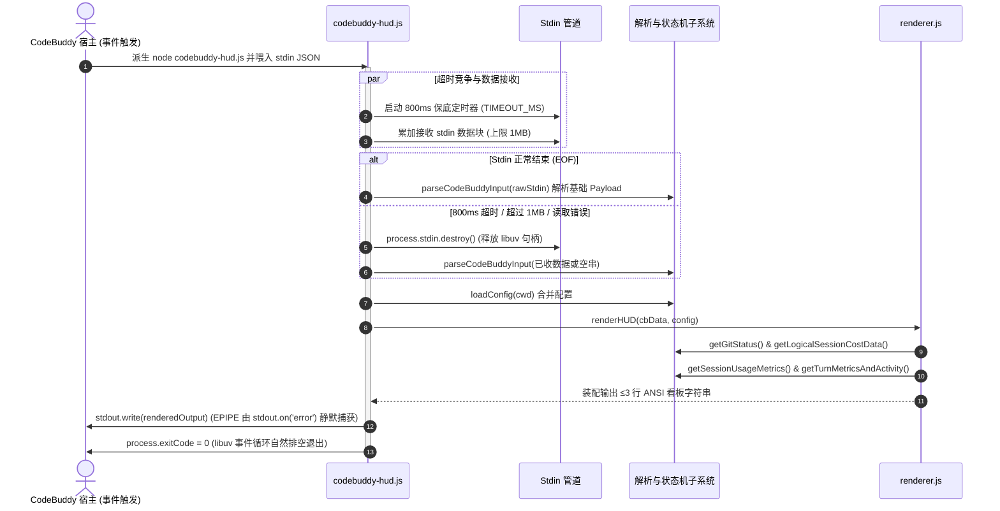

# CodeBuddy HUD 系统架构设计全景文档

> **目标版本：** `v0.3.9+`  
> **宿主兼容性：** CodeBuddy Code CLI（涵盖最新 v2.171.0+；受下文说明的 Windows 引号兼容与三行显示契约约束）
> **底层运行环境：** 纯 Node.js 标准库 (`>= 18.0.0`，绝对零外部 npm 依赖)

---

## 1. 架构总览与核心设计哲学

`codebuddy-hud` 是专为 **CodeBuddy Code** AI 结对编程终端助手量身打造的高性能状态栏看板插件。它在宿主触发会话事件时以极低的系统开销渲染紧凑、高信息密度的 ANSI 彩色状态看板；空闲、只读工具执行与流式生成期间不刷新。

### 核心架构不变量（不可动摇的设计红线）：
1. **绝对零外部依赖 (Zero npm dependencies)**：
   - 纯基于 Node.js 原生标准库（`fs`, `path`, `os`, `crypto`, `child_process`, `readline`, `https`, `http` 等）构建，无需执行 `npm install`，分发体积保持在百 KB 级别。
2. **状态栏宿主契约 (Statusline Contract)**：
   - **执行预算**：整体单次执行预算 $\le 1500\text{ms}$，内部 Stdin 超时保底 $800\text{ms}$。定时器不能抢占同步文件调用或 JSON 解析。
   - **恒零退出码保证**：进程必须**恒定以 `process.exitCode = 0` 退出**。任何未捕获的运行时异常均重定向记录至 `~/.codebuddy/codebuddy-hud-error.log`（权限 `0o600`，上限 1MB 自动覆盖轮转），严禁抛出非零 Exit Code 破坏终端主会话。
   - **渲染输出行数约束**：终端渲染输出严格限制在 $\le 3$ 行，与宿主 stdout 前 3 行截断上限对齐，无数据行自动向上裁剪合并。
3. **真实遥测契约 (Truthful Telemetry)**：
   - Prompt Cache 命中率严格取自真实 `transcript.jsonl`（无 payload 兜底，缺失即 `cache --`）；Credits 优先取 transcript checkpoint，仅在完全无 transcript 遥测时回退 payload 明示值，扫描未完成时隐藏。**绝对严禁硬编码或伪造假数据**。

---

## 2. 两层物理分层架构 (Two-Layer Design)

`codebuddy-hud` 实现了插件元数据声明层与底层运行时执行层的物理隔离：

```
┌──────────────────────────────────────────────────────────────────────────┐
│  插件声明层 (PLUGIN LAYER)  CodeBuddy/Agent 识别入口 (根目录与 skills/)  │
│   .codebuddy-plugin/plugin.json · skills/hud-config/SKILL.md             │
└────────────────────────────────────┬─────────────────────────────────────┘
                                     │  bootstrap.js 执行原子安装与覆盖
┌────────────────────────────────────▼─────────────────────────────────────┐
│  运行时执行层 (RUNTIME LAYER)  ~/.codebuddy/codebuddy-hud-runtime/ 或本地源码检出 │
│   runtime/bin/codebuddy-hud.js    ← 注册到 settings.json 的 statusLine   │
│   runtime/bin/codebuddy-hud.cmd   ← Windows 平台绝对路径 Shim 启动脚本   │
│   codebuddy-hud.config.json (内置默认配置模板；主题预设在 config.js)     │
│   parser.js · config.js · paths.js · encoding.js · git.js · sanitize.js  │
│   lang.js · model-info.js · settings-file.js · statusline-installer.js   │
│   theme-selector.js · doctor.js · session-stats.js                       │
│   transcript.js (逆向滑窗扫描与 SHA-256 增量遥测状态机) · uninstall.js   │
│   update-checker.js (--update 版本解析与自举升级)                        │
│   renderer.js (3 行看板装配引擎) ──> renderer/ (format, diff, agents)    │
└──────────────────────────────────────────────────────────────────────────┘
```

- **插件声明层 (Plugin Layer)**：包含 `.codebuddy-plugin/` 元数据声明与 `skills/hud-config/`，提供 AI Agent 自助交互配置能力。
- **运行时执行层 (Runtime Layer)**：包含所有核心业务逻辑、渲染管道、状态机缓存与跨平台 Shim 适配脚本。

---

## 3. 模块依赖拓扑图 (Module Dependency Graph)

> **注**：本图展示核心执行主链路与关键子系统流转；模块签名、常量与持久化契约详见 [docs/module-reference.md](module-reference.md)。

```mermaid
graph TD
    Entry["runtime/bin/codebuddy-hud.js"] --> Parser["runtime/parser.js"]
    Entry --> Config["runtime/config.js"]
    Entry --> Renderer["runtime/renderer.js"]
    Entry --> Doctor["runtime/doctor.js"]
    Entry --> ThemeSelector["runtime/theme-selector.js"]
    Entry --> Installer["runtime/statusline-installer.js"]
    Entry --> Uninstall["runtime/uninstall.js"]
    Entry --> UpdateChecker["runtime/update-checker.js (--update)"]
    Entry --> Paths["runtime/paths.js"]
    Entry --> Sanitize["runtime/sanitize.js"]
    Entry --> Lang["runtime/lang.js"]

    Config --> SettingsFile["runtime/settings-file.js"]
    Config --> Paths
    SessionStats["runtime/session-stats.js"] --> Parser
    SessionStats --> Paths
    ModelInfo["runtime/model-info.js"] --> Paths
    ModelInfo --> SettingsFile
    Git --> Paths
    Encoding --> Paths

    Renderer --> Transcript["runtime/transcript.js"]
    Renderer --> SessionStats
    Renderer --> Format["runtime/renderer/format.js"]
    Renderer --> DiffRender["runtime/renderer/diff-render.js"]
    Renderer --> AgentsRender["runtime/renderer/agents-render.js"]
    Renderer --> Encoding["runtime/encoding.js"]
    Renderer --> Git["runtime/git.js"]
    Renderer --> Sanitize
    Renderer --> Parser
    Renderer --> ModelInfo["runtime/model-info.js"]
    Renderer --> Lang

    Transcript --> Sanitize
    Transcript --> Paths
    Doctor --> Lang
    Doctor --> Paths
    Doctor --> Encoding
    Doctor --> Git
    Doctor --> Config
    Doctor --> Sanitize
    Doctor --> SettingsFile
    ThemeSelector --> Config
    ThemeSelector --> Paths
    ThemeSelector --> Sanitize
    ThemeSelector --> Lang
    ThemeSelector --> Format
    Installer --> Paths
    Installer --> SettingsFile
    Installer --> Sanitize
    Installer -.->|lazy| ThemeSelector
    Uninstall --> Paths
    Uninstall --> SettingsFile
    Uninstall --> Sanitize
```



---

## 4. 单次交互执行流与生命周期时序 (Execution Flow)

宿主（实测至最新 v2.171.0）在 **session / result / permission / settings / cost** 五类离散事件后约 **300ms** 去抖触发 HUD。单次执行有 **5000ms wall-clock 硬超时**；stdout 捕获上限为 **10240 个 UTF-16 字符**（先判长度再追加），最终只取前 3 行。空闲与只读工具执行时不周期刷新；命令失败会清空 HUD，且不会自动定时重试。



---

## 5. 核心子系统与底层机制深度解析

> 本节只讲各子系统「为什么这样设计」；签名、常量、判据、状态文件 schema 一律以 [module-reference.md](module-reference.md) 对应章节为唯一来源。

### 5.1 逆向滑窗遥测扫描 (`transcript.js`)
Prompt Cache 命中、实际 Credits 与工具调用序列只存在于可达数十 MB 的 `transcript.jsonl`，因此只读文件尾部：单次逆向回扫同时聚合本轮 usage 与工具活动，跨块断行拼装，遇到最近的 `role: 'user'` 即截断，使指标代表**当前这一轮**；单轮超出扫描预算时窗口自然停在最近调用，口径自适应为**近期调用命中率**（`sum(hitTokens) / sum(promptTokens)`）。会话累计 Credits 另走前向增量扫描（见 §5.4）。上下文新鲜度 `contextStatus`（`fresh`/`stale`/`unknown`）用于识别 `/compact` 后宿主仍回传旧 usage 的窗口期，并兼容 DeepSeek 等把 miss 记为 creation、导致宿主输入被扣减为 0 的上报形态。预算常数、字段优先级与 `createContextTracker` / `resolveReportedInputs` / `getCompactContextStatus` 详见 [module-reference.md §10](module-reference.md#10-runtimetranscriptjs--逆向滑窗遥测与-checkpoint-状态机)。

### 5.2 Git 分支与状态非阻塞探测 (`git.js`)
目标是让每一帧都不为 Git 付出子进程代价：优先直读 `.git/HEAD` 零派生，仅在需要脏状态时免 shell 直连 `git status`（短超时），并以分级正/负缓存防止失败或非仓库目录反复派生；`child_process` 懒加载。精确超时、TTL 与 `CODEBUDDY_HUD_NO_GIT_CACHE` 语义见 [module-reference.md §12](module-reference.md#12-runtimegitjs--git-分支与状态探测器)。

### 5.3 会话基线捕获与 `/clear` 判定 (`session-stats.js`)
`/clear` 会清空上下文窗口，但宿主累计的行数、耗时与 token 可能出现负增量或残留历史，因此 HUD 在状态目录记录会话基线，并在检测到「上下文断崖 / 回到初值 / 累计量倒退 / transcript 或 session 切换 / 显式清除信号」等重置迹象时重建基线，使 Δ 与 ⏱ 严格反映当前会话增量。identity 未命中即视为新会话，直接以当前 payload 累计为新基线，不依赖任何跨 identity 共享状态（旧 handoff 机制已退役）。判定条件、阈值与状态 schema 见 [module-reference.md §11](module-reference.md#11-runtimesession-statsjs--会话基线与-clear-重置状态机) 与 [§15](module-reference.md#15-runtimepathsjs--跨平台路径解析与目录管理)。

### 5.4 增量 SHA-256 Credits Checkpoint (`transcript.js`)
每次事件都全量重扫长 JSONL 会重复解析已有消费记录，因此以 transcript 绝对路径的 SHA-256 隔离状态文件，仅从 `offset` 增量解析，并以大小、mtime/ctime 与内容哈希识别截断、轮转与原地覆写后整体重建。扫描受 100ms 预算约束：未完成时保存进度并返回 `complete: false`，渲染层**隐藏** Credits 且不回退 payload（真实遥测契约，见 §1）；写到一半的尾行留待下次续读。预算、失效条件与 version 5 schema 见 [module-reference.md §10](module-reference.md#10-runtimetranscriptjs--逆向滑窗遥测与-checkpoint-状态机) 与 [§15](module-reference.md#15-runtimepathsjs--跨平台路径解析与目录管理)。

### 5.5 多层级配置合并与主题引擎 (`config.js`)
配置按「内置默认 → 随包 → 用户全局 → 项目局部」四层 `deepMerge`，再由 `resolveTheme` 后处理（后处理而非合并层；`--theme <name>` 是写入用户配置的持久操作，不是运行时覆盖层）。项目配置不可信，因此合并跳过 `__proto__`、限制递归深度，主题覆盖值只能是严格 SGR 序列或受限短字符串，未知颜色名降级为无样式文本，阻断项目配置的终端注入。effort 的 transcript 信号按 transcript 哈希持久化，使长任务可凭尾部扫描裁决并在冷启动时有兜底。5 套预设、校验规则与 effort 解析链见 [module-reference.md §3](module-reference.md#3-runtimeconfigjs--多层配置合并与主题引擎) 与 [§8](module-reference.md#8-runtimemodel-infojs--推理强度归一化与额度回退)。

### 5.6 3 行自适应布局 (`renderer.js`)
宿主（源码复核至最新 v2.171.0 仍为常量）仅保留 stdout 前 3 行，HUD 的 3 行输出契约与之严格对齐：Line 1 标识与状态、Line 2 Tokens 与上下文、Line 3 变更/消费/耗时并**并入工具活动**，确保关键信息在截断下完整可见；无数据的行整行隐藏，字段缺失以 `--` 占位。Line 2 以 `fresh` / `stale` / `unknown` 三态表达上下文数据的可信度，避免 `/compact` 后展示过期数字。各行字段、排版与三态渲染细则见 [module-reference.md §4](module-reference.md#4-runtimerendererjs--3-行看板装配与布局编排)。

---

## 6. 终端安全威胁模型与过滤机制

所有外部文本输出前必须调用 `runtime/sanitize.js` 的 `sanitizeTerminalText()`：

| 攻击威胁 | 载荷示例 | 防御过滤实现 (`runtime/sanitize.js`) |
| :--- | :--- | :--- |
| **ANSI CSI 注入** | `\x1b[2J\x1b[H` (清屏覆盖攻击) | 正则剔除 `/\x1b\[[0-?]*[ -/]*[@-~]/g` |
| **OSC 剪贴板/标题劫持** | `\x1b]52;c;...\x07` (剪贴板注入) | 正则剔除 OSC（含 C1 `0x9D` 形式）至 BEL / ST(`\x1b\\`、`0x9C`) / 输入结尾 |
| **DCS/APC/PM/SOS 串式注入** | `\x1bP+q544e\x1b\\`、`\x1b_G...\x1b\\` | 整串吞至 ST 或未终止串结尾（含 C1 `0x90/0x98/0x9E/0x9F` 形式），payload 不残留 |
| **Unicode Bidi 伪装** | `\u202E` (从右向左覆盖伪装) | 剔除 `U+200B` ~ `U+200F`、`U+202A` ~ `U+202E`、`U+2028/U+2029`、`U+2060`、`U+2066` ~ `U+206F`、`U+061C` 等格式控制符 |
| **C0/C1 控制符污染** | `\x00-\x1F`, `\x7F-\x9F` | 剔除全部 C0/C1 控制符（含 NUL 与单字节 `0x9B` CSI / `0x9D` OSC 等，串式序列按上表整串处理） |
| **超长字符串溢出** | 50,000 字符的畸形 Git 分支名 | 按视口安全边界强制截断（默认上限 120 字符，调用点按场景收紧至 10~1024） |

---

## 7. 故障降级与容灾矩阵 (Failure Degradation Matrix)

| 故障场景 | 诱发原因 | 系统降级表现 | Exit Code |
| :--- | :--- | :--- | :---: |
| **空 Stdin / 异常数据** | 宿主提前触发（payload 未就绪）/ 超过 1MB / 非法 JSON | 不输出任何行（0 字节）并安全退出；向错误日志写入一行带原因诊断，不伪造遥测 | `0` |
| **Stdin 管道悬挂** | 宿主未按时发送 EOF 结束管道 | $800\text{ms}$ 定时器触发，强行切断 Stdin 并按已收数据渲染 | `0` |
| **EPIPE 错误** | 宿主提前关闭 Stdout 接收管道 | `process.stdout.on('error')` 静默捕获，安全退出 | `0` |
| **Transcript 缺失** | 首轮会话 / 远程无盘环境 | 隐藏工具活动，Token 回退使用 payload；Credits 仅使用 payload 明示的实际值 | `0` |
| **状态文件截断损坏** | 异常断电 / 进程被强杀 | 自动丢弃损坏 JSON，重置偏移量为 0 全量重建 | `0` |
| **只读文件系统** | 权限受限的容器环境 | 状态写入静默失败；未完成的 Credits 隐藏，后续调用可能从头重建 | `0` |
| **Git 超时 / 探测失败** | 庞大 Mono-repo / 非可用仓库目录 | 若能直接读出分支则保留分支并返回 `dirty: null`；仅无 HEAD 可回退时记录 60s 负缓存防重复派生 | `0` |

---

## 8. 跨平台与零依赖设计保障

1. **Windows `.cmd` Shim 绝对路径烘焙**：
   - `statusline-installer.js` 在 `--setup` 时将当前环境的 `process.execPath` 绝对路径固化写入 `.cmd`。
   - 自动将路径中的 `%` 批量转义为 `%%`，免疫 `cmd.exe` 变量误展开。
   - 当路径包含非 ASCII 字符时，通过 `resolveShortPath()` 解析 Windows 8.3 短路径并强制注入 `@chcp 65001 >nul`，彻底规避批处理对非 ASCII 路径解析崩溃。
   - shim 为 UTF-8，必要时先 `chcp 65001`；实测 cmd.exe 不支持 UTF-16LE 批处理文件。
   - 针对 Windows 宿主启动器可能二次转义字面引号的兼容限制，安全 ASCII shim 路径省略引号；需要引号的路径保留引号，仍受宿主兼容限制。
2. **终端编码自动探测与缓存**：Windows 下免壳直连 `chcp.com` 探测代码页，成功与失败采用不同缓存时长，避免偶发尖刺把 ASCII 降级锁死一小时；`CODEBUDDY_HUD_FORCE_ASCII`/`UNICODE` 优先。不支持 UTF-8 的终端自动回退纯 ASCII 字符集（`#`, `-`, `|`, `[A]`, `[Q]`, `[D]`, `[t]`, `[T]`）。TTL 与超时见 [module-reference.md §13](module-reference.md#13-runtimeencodingjs--终端字符集探测与编码缓存)。
3. **事件循环自然排空退出 (Natural Drain)**：渲染完成后主动释放 Stdin 句柄与定时器，依靠事件循环自然排空退出，杜绝 `process.exit()` 截断异步 stdout 缓冲区而输出半截 ANSI；stdout `EPIPE` 同理静默捕获（见 §7）。
4. **配置写入与卸载清理**：settings 写入保留字符串内容、权限与符号链接，拒绝多硬链接目标（[§16](module-reference.md#16-runtimesettings-filejs--jsonc-安全解析与配置原子写入)）；卸载只还原非本 HUD 的 `statusLine`，并对称清理技能挂载、shim、缓存与系统 PATH 注册，测试沙箱（`CODEBUDDY_HOME` 已设）下跳过 PATH 清理（[§20](module-reference.md#20-runtimeuninstalljs--卸载还原与深度清理)）；`setup` 的技能挂载见 [§17](module-reference.md#17-runtimestatusline-installerjs--状态栏注册与-shim-烘焙器)。
5. **验证隔离**：安装卸载测试必须同时隔离 runtime、settings 和用户目录；仅设置 `CODEBUDDY_HOME` 不能保护真实 shim（见 [§25](module-reference.md#25-scriptsverify-installjs--隔离宿主生命周期验证)）。
